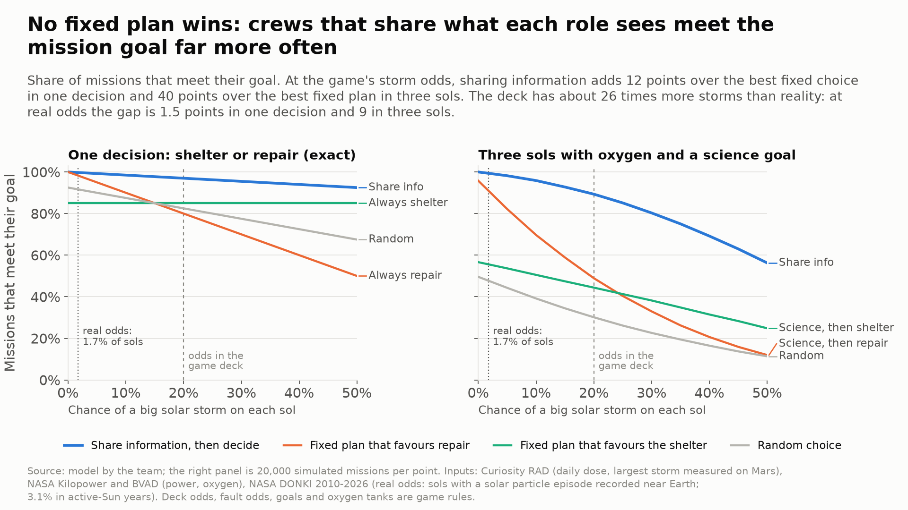
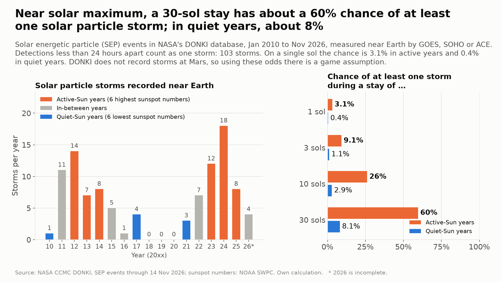
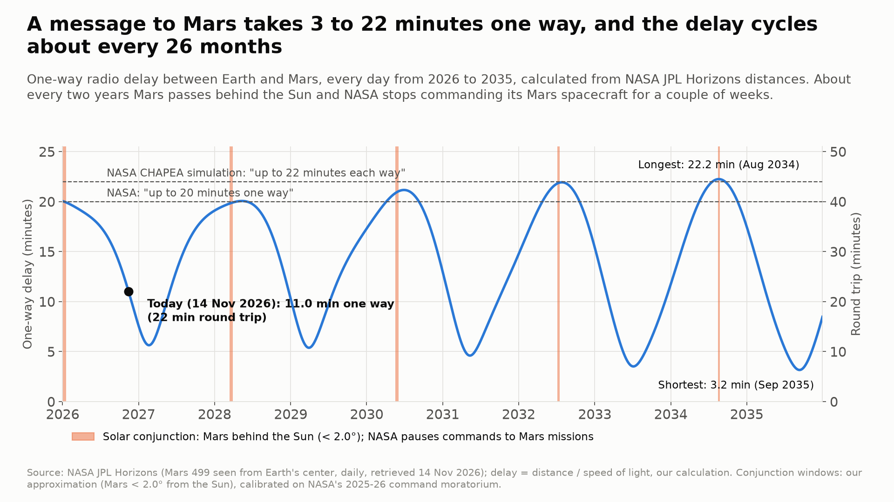
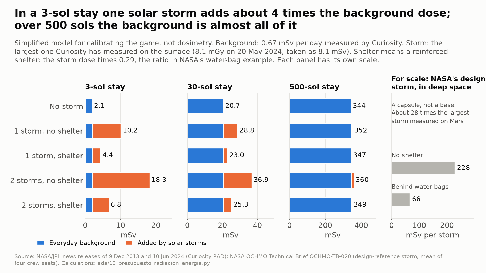
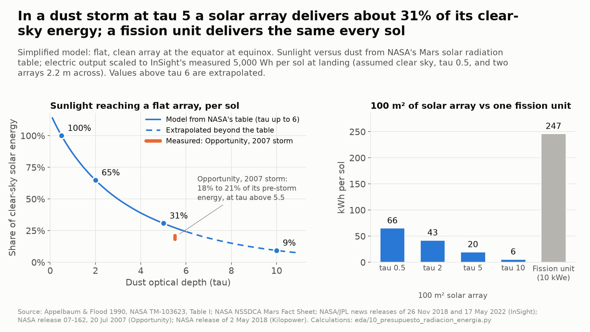

# Two Small Steps

### ▶ Play it in your browser: **https://royito06.github.io/NasaSpaceApps2026/play/**

No download, no account. Ages 7 to 12, about 15 minutes. One player, or two players sharing one keyboard or touch screen.

**NASA Space Apps 2026, Hermosillo, Mexico · Team El Nuevo Imperio Azteca**
**Challenge:** *Build a Junior Astronaut Mission Trainer* ([official text](CHALLENGE.md))

*An independent student project inspired by NASA's expeditionary skills. Not a NASA product, and not endorsed by NASA.*

---

## The game in one minute

Kids don't memorize facts. They make decisions that cost something, and see the consequence the next day.

- **Level 1, the Moon (Apollo 15, 1971).** Drive the rover. The rare white rock is far away, and bringing it back uses most of your spare oxygen for the walk home. Mission Control answers in 2.6 seconds: on the Moon, Earth can still help.
- **Level 2, a Mars outpost.** Two roles each report half of the picture: **Engineering** sees the power fault, **Protection** sees the solar storm. There is time for one job: reinforce the shelter or repair the power, and both roles must agree. Earth's answer needs 40 minutes and the storm arrives in 30, so **the crew decides alone**.
- **Three things to manage:** power, oxygen and radiation. Low power means the oxygen machine fills fewer tanks tonight and the greenhouse lamp stays off, so the choice shows up the next sol and again on harvest day (lettuce takes 28 days).
- **No answer always wins.** The job that wins on sol 30 can lose on sol 31. A **free mission** of three sols is different every time, with storm cards drawn from real NASA DONKI events, and ends in "Mission goals met" or "Mission strained", never "you lose".
- **Predict first, then decide, then explain.** A crew logbook, saved only on the device, shows how the crew improves.

## Real NASA data, and how each piece drives a mechanic

Every number in the game carries a tag: **Measurement**, **Calculation** or **Game rule**. The full list with links is in [`game/REFERENCES.md`](game/REFERENCES.md) and on the in-game "NASA data" screen.

| NASA data | Mechanic in the game | Why it matters |
|---|---|---|
| **Apollo 15 Mission Report** and **Apollo Lunar Surface Journal** | Level 1: the 5 km line (the farthest Apollo 15 drove from its lander), 7 hours of suit oxygen, the Genesis Rock | A real mission's real safety rule: never drive farther than you can walk back |
| **NASA DONKI** (space weather) | The Mars storm (the eruption of 20 May 2024), the free mission's storm cards, and a **live request** on the bonus sol that decides whether a storm comes | Links the shielding decision to actual space weather; archived data is always labelled as archived |
| **Curiosity RAD** (NASA JPL) | Radiation counted in "sols of normal radiation" (0.69 mSv per sol); the storm's size (8.1 mGy measured on 20 May 2024) | A real radiation reading from the surface of Mars |
| **NASA NSSDCA fact sheets** (distance ÷ speed of light) and **JPL Horizons** | 2.6 seconds to the Moon and back vs 3 to 22 minutes each way to Mars | Communication delay: why the Mars crew must decide alone |
| **NASA Life Support Baseline Values (BVAD)**, **MOXIE**, **Veggie** | Oxygen tanks (0.895 kg of oxygen per crew member per day), the oxygen machine, the 28-day lettuce harvest | "A choice that saves power today might cost oxygen tomorrow" |
| **NASA Human Research Program** risk ratings | Two roles with split information, and Earth's late answer | Teamwork and Earth-independent operations are two of the three human risks rated highest for Mars |
| **NASA Open Science Data Repository**, study OSD-342 | A fact on the mission report: mice lost 18% of a calf muscle after 33 days in microgravity | Real astronaut-health research, explained in plain words (mice, not astronauts) |
| **NASA Image and Video Library** | The NASA terminal fetches Apollo 15 photo AS15-86-11603 and Curiosity image PIA26302 during play | Real photos, fetched live and labelled "Fetched from NASA just now" |

## Balance: no safe choice

We simulated 20,000 three-sol missions. Always sheltering, or always repairing, meets the goals 0% of the time. Reading both roles' reports and deciding together meets them in 89.3%. The free mission implements that model, and its built-in self-test met the goals in 274 of 300 missions. Storms come about 26 times more often than in reality so that something happens in three sols: that is a game rule, and the game says so.

| | |
|---|---|
|  |  |
|  |  |

## Why Hermosillo, and what's next

Built in Hermosillo, in English and Spanish, with voice, touch controls and a less-motion setting. In Mexico, 80.5% of kids aged 10 to 14 spend more than two hours a day on screens, and 34.6% are physically active (ENSANUT 2022–2024). Only 30% of Mexican students reach basic level in PISA 2025 mathematics, against 65% across the OECD.

**Testing with children is pending.** The next step is a pilot in Hermosillo schools, using the [teacher card](TEACHER_CARD.md) and the crew logbook to check whether a child can explain what their crew gave up and why.

## What's in this repo

| Folder / file | What it is |
|---|---|
| [`play/`](play/) | The web build served at the play link |
| [`game/`](game/) | Godot 4 source code and assets; [`game/REFERENCES.md`](game/REFERENCES.md) lists every NASA dataset and asset |
| [`TEACHER_CARD.md`](TEACHER_CARD.md) | One page for a 15-minute classroom session |
| [`REFERENCES.md`](REFERENCES.md) | Every external resource: data, research, assets, software and AI tools |
| [`pitch/`](pitch/) | The 7-slide deck (PDF and PPTX), its outline with a source for every number, and real missions behind the mechanics |
| [`eda/`](eda/) | Data analysis scripts, tables and figures |
| [`game_design_drafts/`](game_design_drafts/) | Design notes |
| [`CHALLENGE.md`](CHALLENGE.md), [`JUDGING.md`](JUDGING.md) | Official challenge text and judging rules |

## How it was made

- Engine: Godot 4.7 (MIT). Art: human-made CC0 and CC BY assets (Kenney, KayKit, game-icons.net) and NASA imagery. **No AI-generated images.**
- The team used AI assistants (Claude by Anthropic and Gemini by Google) to help with code, data analysis and writing.
- NASA data is public domain; using it does not imply NASA endorsement. Other licenses are listed in [`REFERENCES.md`](REFERENCES.md).
