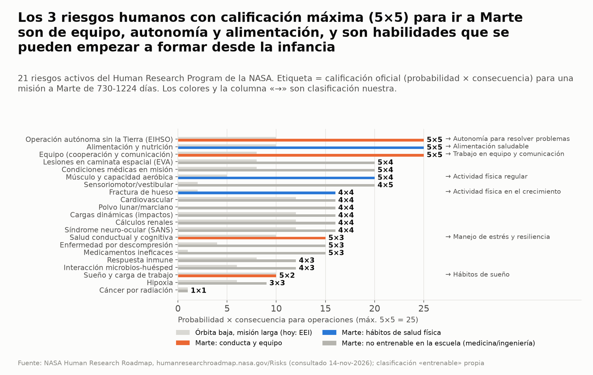

# Junior Astronaut Mission Trainer · NASA Space Apps 2026 (Hermosillo, México)

**Challenge:** *Build a Junior Astronaut Mission Trainer*: a game that teaches kids aged 7–12 the real trade-offs of running a lunar or Martian outpost ([official text](CHALLENGE.md)).

## The idea in one minute

On Mars, a message to Earth takes **3 to 22 minutes each way**, so the crew has to decide on its own.

In our game, two kids play two roles that each see something the other can't:
- **Engineering** sees that the power equipment needs repair.
- **Protection** sees a solar storm coming and the state of the shelter.

They have **one work slot** before the storm hits:
- **Reinforce the shelter:** less radiation exposure, but no power repair tonight.
- **Repair the power:** the lights stay on, but more exposure in the existing shelter.

Neither choice is free. They advance one sol, see what each plan saved and what it cost, then **retry the other choice** and compare. A short debrief asks: *What did we give up? What did each of us know? What would we change?*

The solar storm is a **real event recorded by NASA's DONKI** space-weather database, bundled into the game and labelled as archived data. Every number on screen says where it comes from, and whether it is a **measurement**, a **calculation** or a **game rule**.

*An independent educational game inspired by NASA's expeditionary skills. Not a NASA product, and not endorsed by NASA.*

## What's in this repo

| Folder / file | What it is |
|---|---|
| `pitch/DECK_7_SLIDES_EN.md` | The 7-slide demo deck (English) with speaker notes |
| `pitch/historical_missions.md` | Real missions behind the mechanics, plus the 30-second video plan (English) |
| `pitch/PITCH.md`, `pitch/preguntas_jueces.md` | Live pitch script and judge Q&A (Spanish, for the local event) |
| `eda/riesgos_a_mecanicas.md` | Game design: NASA human-spaceflight risks → game mechanics (Spanish) |
| `eda/tables/parametros_juego.csv` | Real values behind the game, each with its source URL |
| `eda/FINDINGS.md` | Data analysis and findings (Spanish) |
| `eda/figures/` | Charts used in the pitch |
| `eda/*.py`, `scripts/fetch_data.py` | Scripts to re-download the data and rebuild every table and figure |
| `CHALLENGE.md`, `JUDGING.md` | Official challenge text and judging rules |

## NASA data we use

- **DONKI** (Space Weather Database of Notifications, Knowledge, Information): real solar storm events.
- **Curiosity RAD:** radiation measured on the surface of Mars.
- **Artemis I** (HERA sensors inside Orion, *Nature* 2024): radiation measured around the Moon.
- **JPL Horizons and the NSSDCA fact sheets:** Earth–Mars and Earth–Moon distances, which give the communication delays.
- **NASA Human Research Program:** the official risk ratings for human spaceflight. Teamwork, working without Earth's help, and food are the top-rated risks for Mars operations.
- **NASA Life Support Baseline Values (BVAD):** oxygen, water and food per astronaut per day.
- **NASA OSDR (Open Science Data Repository):** spaceflight biology studies on bone and muscle.

Local context (why Hermosillo): Mexico's official health survey (ENSANUT, INSP) and OECD PISA 2025. Every value lists its source in `eda/tables/`.

## Figures

| | |
|---|---|
|  |  |
|  |  |

## Sources and licenses

- **NASA data:** public domain (US Government). Use does not imply NASA endorsement.
- **Astronaut database:** Stavnichuk & Corlett (2020), Mendeley Data, CC BY 4.0 (TidyTuesday version).
- **ENSANUT (INSP, México):** published results are cited; the original PDFs are not redistributed here (source lists and checksums are in `data/raw/mexico/*/FUENTES.md`).
- **OECD PISA 2025:** OECD reports. **WHO GHO:** CC BY-NC-SA 3.0 IGO. **World Bank:** CC BY 4.0. **Our World in Data:** CC BY 4.0.
- **CDC YRBSS and NCES NAEP:** US public domain.
