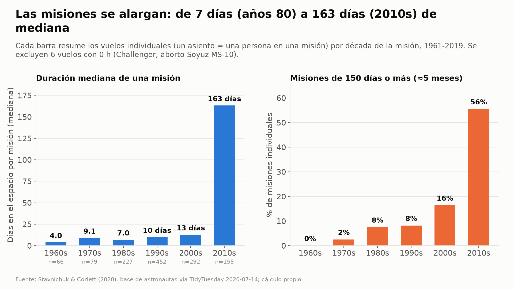
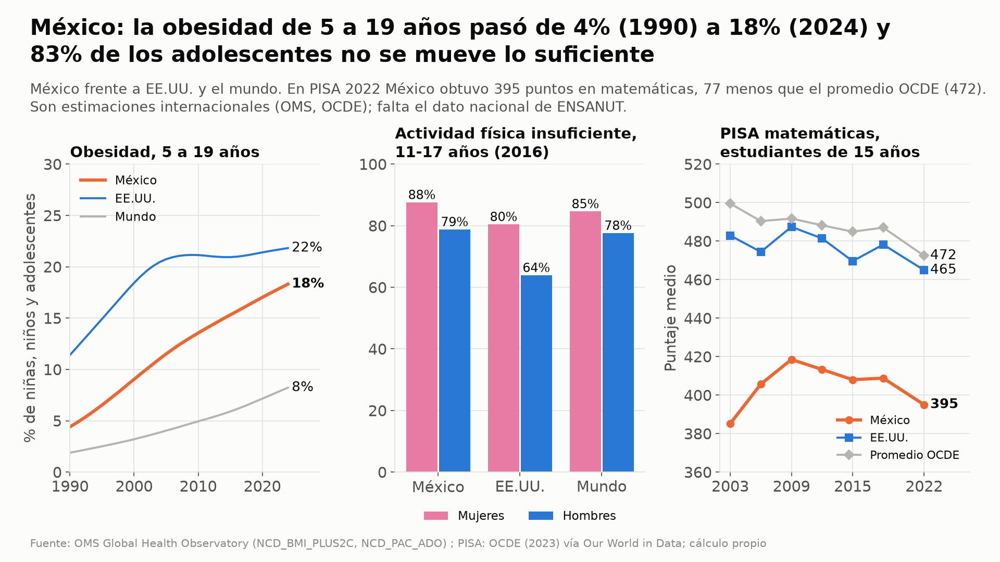
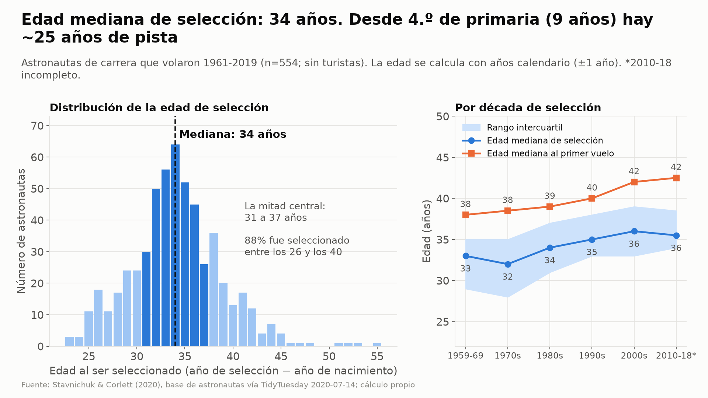
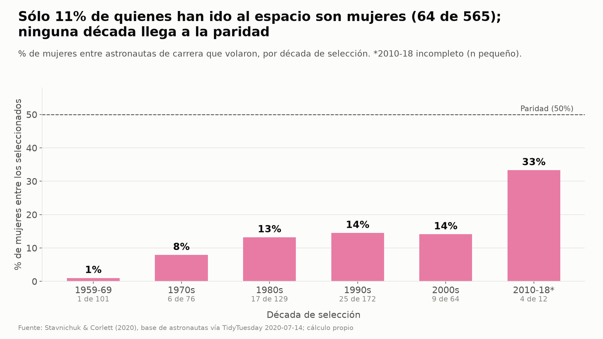
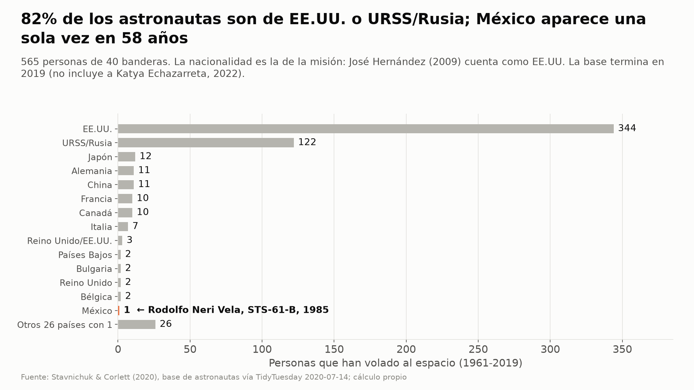
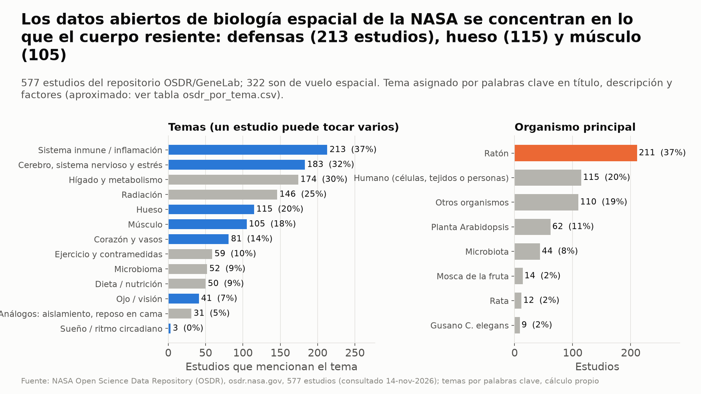
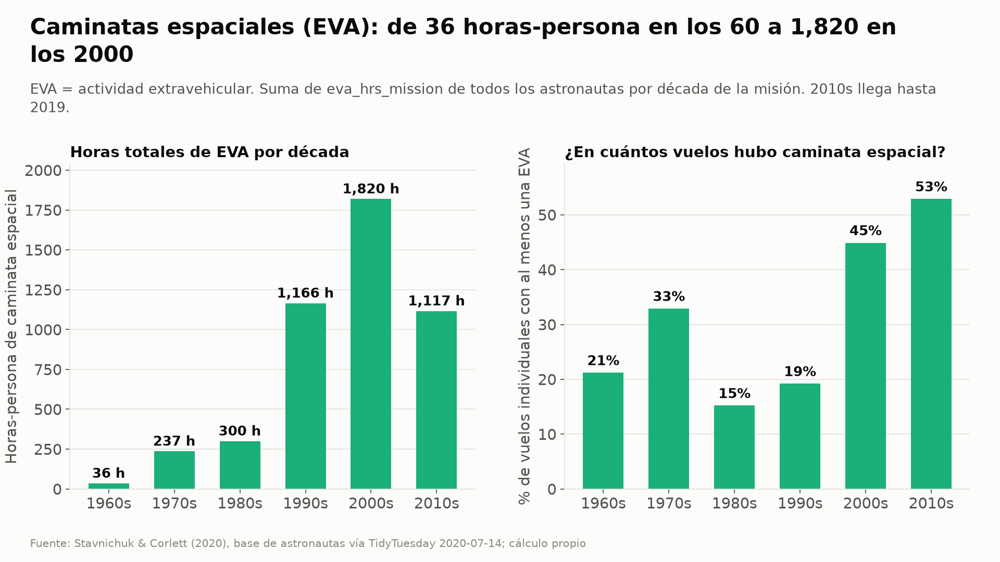

# NASA Space Apps 2026 · Hermosillo

**Reto:** *Build a Junior Astronaut Mission Trainer*

Un entrenador de misiones para niñas, niños y adolescentes (9 a 14 años): un nivel de práctica en la **Luna** y una misión principal en **Marte**. Además de administrar soporte vital, energía, comida y blindaje contra radiación, la tripulación debe cuidarse a sí misma: trabajo en equipo, decisiones sin ayuda de la Tierra y alimentación. Son justo los 3 riesgos humanos que la NASA califica con el máximo (5×5) para una misión a Marte.

Este repositorio contiene los **datos, tablas y figuras** del análisis exploratorio (EDA) que respalda el diseño del juego.

## Qué hay aquí

| Ruta | Contenido |
|---|---|
| [`eda/FINDINGS.md`](eda/FINDINGS.md) | Hallazgos principales, ordenados por su uso en el juego, con fuente y advertencias |
| [`eda/riesgos_a_mecanicas.md`](eda/riesgos_a_mecanicas.md) | Cada riesgo del Human Research Program de la NASA → mecánica de juego propuesta |
| [`eda/tables/parametros_juego.md`](eda/tables/parametros_juego.md) | Valores reales de la NASA para las mecánicas (oxígeno, agua, comida, radiación, retraso de comunicación, energía, cultivos) |
| `eda/figures/` | 13 figuras en español, listas para presentación |
| `eda/tables/` | Las tablas CSV detrás de cada figura y de cada número |
| `eda/*.py` | Scripts para regenerar tablas y figuras (sólo numpy y matplotlib) |
| `scripts/fetch_data.py` | Descarga de las fuentes públicas (sólo biblioteca estándar de Python) |
| `data/raw/` | Datos crudos pequeños (astronautas, OMS, Banco Mundial, Our World in Data) |

## Figuras

| | |
|---|---|
|  |  |
|  |  |
|  |  |
|  |  |

Las demás figuras están en [`eda/figures/`](eda/figures/).

## Cómo regenerar

```bash
python3 scripts/fetch_data.py --out data/raw small   # fuentes NASA, NAEP y CDC pequeñas
python3 eda/00_fetch_mexico.py                       # OMS, Banco Mundial, Our World in Data
for f in 01_astronautas 02_hrp_osdr 03_jovenes_eeuu 04_mexico 05_riesgos_a_mecanicas; do python3 eda/$f.py; done
```

Algunos crudos grandes (CDC YRBSS, ~6 GB) no están en el repositorio. Se procesaron por separado; sus resúmenes están en `eda/tables/ramona/`.

## Fuentes y licencias

- **NASA:** Human Research Roadmap (humanresearchroadmap.nasa.gov), Open Science Data Repository (osdr.nasa.gov) y el Life Support Baseline Values and Assumptions Document (BVAD). Los datos de la NASA son de dominio público; esto no implica respaldo de la NASA.
- **Base de astronautas:** Stavnichuk & Corlett (2020), *Astronaut database*, Mendeley Data (CC BY 4.0), en la versión de TidyTuesday.
- **OMS:** Global Health Observatory (CC BY-NC-SA 3.0 IGO).
- **Banco Mundial:** World Development Indicators (CC BY 4.0).
- **Our World in Data:** datos PISA de la OCDE (CC BY 4.0).
- **CDC:** YRBSS (dominio público de EE.UU.).
- **NAEP / NCES:** dominio público de EE.UU.
- **ENSANUT (INSP, México):** se citan los resultados publicados en ensanut.insp.mx; los PDF originales no se redistribuyen aquí.

Cada número en `eda/` indica su fuente y su URL. Si un dato no se pudo verificar, aparece como `[DATO PENDIENTE]`.

Proyecto independiente para NASA Space Apps Challenge 2026; no es un producto oficial de la NASA.
