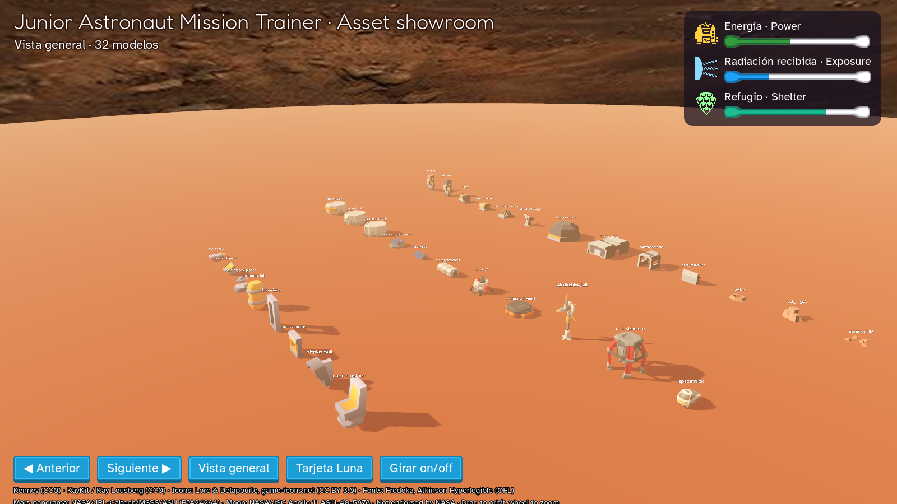
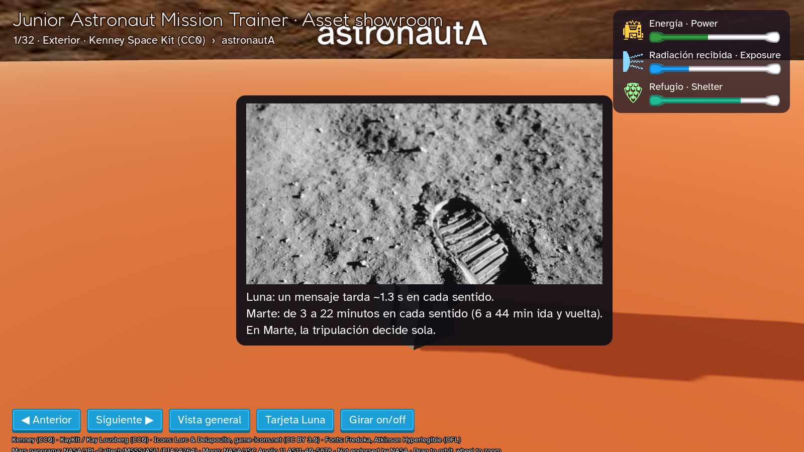

# 05 · Assets (human-made, free to use)

We built a quick "showroom" in Godot with these assets on a Mars ground and the real Perseverance panorama:




*Screenshots from the desktop build. Kenney astronauts are quite blocky; Quaternius animal astronauts are the cuter alternative.*


Rules: **no AI-generated imagery**; licenses checked on each asset's own page; no Chinese-owned sources. Every asset used goes in `game/REFERENCES.md` (template at the bottom).

## Starter kit: one coherent look (flat low-poly, white/orange palette)

| # | Covers | Asset | License | Attribution | Notes |
|---|---|---|---|---|---|
| 1 | **Mars exterior:** terrain, craters, rocks, habitat pieces, **generators (power)**, satellite dish, rover, 2 astronauts, desk/computer | **Kenney Space Kit**, https://kenney.nl/assets/space-kit | CC0 | none (optional "Kenney") | itch page: "No generative AI was used". `.glb`. **Don't import the weapon/turret models.** Check astronautA/B in the zip. |
| 2 | **Mars interior:** walls, floors, doors, windows, beds, computers, wall switches, containers | **Kenney Space Station Kit**, https://kenney.nl/assets/space-station-kit | CC0 | none | No-AI stated. glTF. Recolour its single colormap toward warm gray/orange. |
| 3 | **Habitat domes (shelter)**, solar panels, roof solar, tunnels, landers, terrain | **KayKit Space Base Bits**, https://kaylousberg.itch.io/space-base-bits | CC0 | none (optional "Kay Lousberg") | No-AI stated. `.gltf`: keep `.bin` and the atlas together. Matches Kenney's palette. |
| 4 | Cute astronauts (optional) | **Quaternius astronauts** (frog/bee/flamingo/human), https://poly.pizza/m/0D54W8yfrA · /OgeSH89Nmx · /zbtPq4dOJL · /3hC2i0CTuO | CC0 | none | **Delete the gun-like prop node.** The source pack is unverified. |
| 5 | **UI:** big rounded buttons, panels, sliders (use them for the power/exposure bars) | **Kenney UI Pack**, https://kenney.nl/assets/ui-pack | CC0 | none | No-AI stated. PNG + SVG. No bar sprites, so build bars from the slider track and fill. |
| 6 | **Icons:** radiation, power, shield, gears, dome, helmet, storm, water, health, sun | **game-icons.net** (Lorc, Delapouite), https://game-icons.net | **CC BY 3.0** | **Required:** "Icons made by {author}. Available on https://game-icons.net" | Monochrome SVG; recolour. Skip the violent icons. |
| 7 | **Body font** (early readers, Spanish accents verified) | **Atkinson Hyperlegible**, https://github.com/google/fonts/tree/main/ofl/atkinsonhyperlegible | OFL 1.1 | "Copyright 2020 Braille Institute of America, Inc." + OFL.txt | 54 KB TTF. |
| 8 | **Title/button font** | **Fredoka**, https://github.com/google/fonts/tree/main/ofl/fredoka | OFL 1.1 | "Copyright 2016 The Fredoka Project Authors" + OFL.txt | If its variable axes misbehave on web, use Lilita One (OFL, 28 KB). |
| 9 | **Mars backdrop** | NASA **PIA24264** "Mastcam-Z's First 360-Degree Panorama", https://science.nasa.gov/photojournal/mastcam-zs-first-360-degree-panorama/ | NASA media | **"NASA/JPL-Caltech/MSSS/ASU"** (exact) | Real Jezero crater; no people, no logo. Crop the terrain strip. |
| 10 | **Moon comparison card** | NASA Apollo 11 bootprint **AS11-40-5878**, https://science.nasa.gov/3d-resources/moon-apollo-astronaut-bootprint/ | NASA media | "NASA/JSC (Apollo 11, AS11-40-5878)" | Downscale for web. |
| 11 | Sky lighting (optional) | **Goegap HDRI**, Poly Haven, https://polyhaven.com/a/goegap | CC0 | none | Photographic desert; tint it red. Use the 1k version for web. |
| 12 | Cel shading | Godot built-in `diffuse_toon`/`specular_toon`, or **Toon Shader** (relink), https://godotshaders.com/shader/toon-shader/ | MIT | "relink, Godot Shaders" + MIT text | Mars haze: WorldEnvironment fog + glow (both work in the web renderer). |

**Styles that mix well:** Kenney + KayKit + Quaternius cartoon astronauts; Kenney UI + Fredoka.
**Avoid:** Quaternius *Modular Sci-Fi MegaKit* and *Sci-Fi Essentials* (dark, with guns), and *Universal Base Characters* (realistic bodies). Use realistic NASA models only for "real hardware" cards.
**Gap:** there's no CC0, kid-friendly, clearly diverse human astronaut pack. Helmeted suits avoid the issue; show diversity through portraits or names.

## Web build (Compatibility renderer) limits, from the Godot 4.7 docs
- **Works:** fog, glow, tonemapping, adjustments, screen/depth texture, MSAA.
- **Doesn't work:** volumetric fog, CompositorEffects, SSR, SSIL, SDFGI, VoxelGI, decals, DOF, TAA, FXAA/SMAA.
- **Limits:** 8 omni/spot lights per mesh, low-dynamic-range color.

## Backups and extras
- **Astronaut:** Rigged Astronaut by J-Toastie (CC BY), https://poly.pizza/m/0oBRDJ9Zl9. Easy to tint per role. *Human-made status unverified (2024).*
- **Mars set:** Quaternius Ultimate Space Kit (CC0), https://quaternius.com/packs/ultimatespacekit.html; Kenney Modular Space Kit (CC0).
- **Real NASA hardware cards:** Perseverance GLB (https://science.nasa.gov/3d-resources/mars-2020-perseverance-rover/; check its textures for the NASA logo), Habitat Demonstration Unit (https://science.nasa.gov/3d-resources/habitat-demonstration-unit/, "NASA/LaRC/Advanced Concepts Lab").
- **Globe textures:** Mars.jpg (https://science.nasa.gov/3d-resources/mars/), CGI Moon Kit (https://svs.gsfc.nasa.gov/4720/, credit "NASA's Scientific Visualization Studio").
- **Fonts (OFL):** Lexend, Andika (subset it, 670 KB), Baloo 2, Lilita One, Sniglet, Nunito. Spanish glyphs verified.
- **Textures:** ambientCG (CC0; each page shows how the asset was made). Not needed for low-poly.
- **Shaders:** Depth-Based Outline (CC0), Colorful Sobel Outlines (CC0), official Godot demo projects (MIT). Test them on web.
- **Audio:** Kenney UI Audio and Sci-fi Sounds (CC0).

## NASA media rules (nasa.gov brand center)
- NASA media and 3D data are generally not copyrighted. **Credit NASA**, and **never use the NASA logo, worm or insignia**. Don't imply endorsement.
- Skip third-party-credited items. **NASA's Astronaut.glb is credited to DigitalSpace Corp, so skip it.**
- Avoid the huge models (Gateway, ISS, Z2 suit). The NASA 3D repo has no Orion, SLS or Artemis models.
- Use GitHub, not the Gitee mirror (Chinese).

## Sites to avoid or filter
- Chinese-owned mirrors (Gitee, CSDN, Baidu, etc.), and third-party re-hosts of Kenney packs.
- **itch.io:** accept only pages that show "No generative AI was used".
- **OpenGameArt:** re-uploads by third parties, no AI field.
- **Poly Pizza:** filter to CC0 and known authors.
- **godotshaders:** the license varies per shader, so read each page.
- **Skip Sketchfab, Freepik, Pixabay and CGTrader** (mixed licenses, AI uploads).

## Not verified
- How the Kenney astronauts and rover look (names confirmed, not rendered).
- Which Quaternius pack the Poly Pizza astronauts come from.
- J-Toastie's CC BY version and whether it's human-made.
- Kenney UI Sci-Fi's AI status.
- The licenses of two godotshaders items ("Moving gradient noise fog", "Starry sky").
- Whether NASA model textures contain logos.
- Font readability, tested visually in Godot.

## REFERENCES.md template (keep only what you use)

```markdown
## Credits and licenses

This game is a NASA Space Apps hackathon project. It is not endorsed by NASA.

### 3D models (CC0, credit optional)
- Space Kit and Space Station Kit by Kenney (kenney.nl), CC0 1.0 - https://kenney.nl/assets/space-kit , https://kenney.nl/assets/space-station-kit
- Space Base Bits by Kay Lousberg (KayKit), CC0 1.0 - https://kaylousberg.itch.io/space-base-bits
- Astronaut characters by Quaternius (quaternius.com), CC0 - https://poly.pizza/m/0D54W8yfrA , https://poly.pizza/m/OgeSH89Nmx , https://poly.pizza/m/zbtPq4dOJL

### UI and icons
- UI Pack by Kenney, CC0 1.0 - https://kenney.nl/assets/ui-pack
- Icons made by Lorc and Delapouite. Available on https://game-icons.net . Licensed CC BY 3.0 (https://creativecommons.org/licenses/by/3.0/). Icons used: [list each icon and author]

### Fonts (SIL Open Font License 1.1; OFL.txt copies in /fonts)
- Atkinson Hyperlegible. Copyright 2020 Braille Institute of America, Inc.
- Fredoka. Copyright 2016 The Fredoka Project Authors (https://github.com/hafontia/Fredoka-One)

### Sky and lighting
- Goegap HDRI by Greg Zaal, Poly Haven, CC0 - https://polyhaven.com/a/goegap
- Toon Shader by relink (Godot Shaders), MIT - https://godotshaders.com/shader/toon-shader/

### NASA imagery (NASA content is generally not subject to copyright; credited; no endorsement implied; NASA logo not used)
- Mars panorama PIA24264, "Mastcam-Z's First 360-Degree Panorama" - NASA/JPL-Caltech/MSSS/ASU - https://science.nasa.gov/photojournal/mastcam-zs-first-360-degree-panorama/
- Apollo 11 bootprint photo AS11-40-5878 - NASA/JSC - https://science.nasa.gov/3d-resources/moon-apollo-astronaut-bootprint/
- Usage guidelines: https://www.nasa.gov/nasa-brand-center/images-and-media/

### Human-made statement
All third-party art, models, icons and fonts above are human-made, from creators who state no generative AI was used or from works that predate 2022. No AI-generated imagery is used.
```
